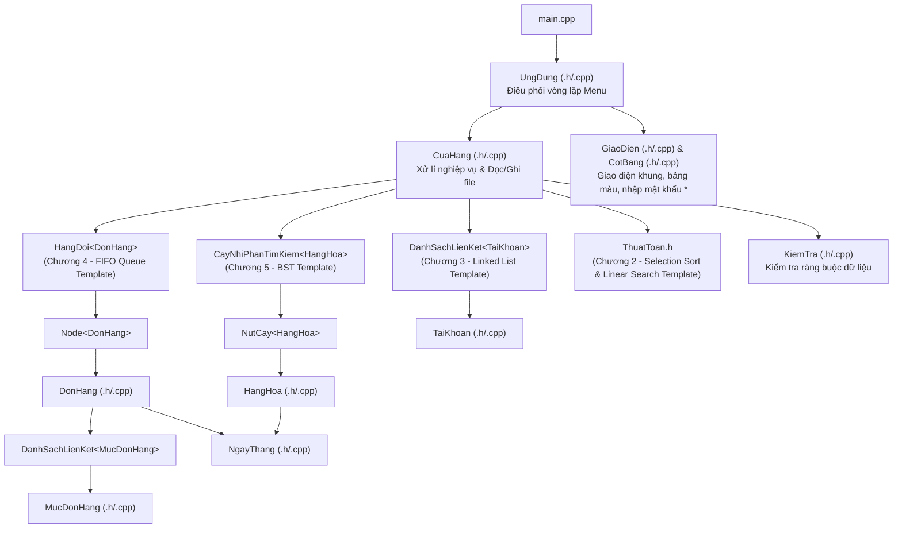

# 🛒 HƯỚNG DẪN SỬ DỤNG CHƯƠNG TRÌNH QUẢN LÍ BÁN HÀNG ONLINE (PRO_CTDL_4)

> **Dự án:** Chương trình Quản lí Bán hàng Online — **Làng Xì Trum Shop**  
> **Mã đề tài:** `PRO_CTDL_4` (Môn Cấu trúc dữ liệu)  
> **Chuẩn cài đặt:** Lập trình Hướng đối tượng (**OOP**) + Khuôn hình (**Template**), tuân thủ **C++ Coding Standard Version 2** (Tổ Khoa học máy tính).

---

## 📑 MỤC LỤC
1. [Giới thiệu tổng quan](#1-giới-thiệu-tổng-quan)
2. [Kiến trúc mã nguồn & Cấu trúc dữ liệu](#2-kiến-trúc-mã-nguồn--cấu-trúc-dữ-liệu)
3. [Hướng dẫn biên dịch và khởi chạy](#3-hướng-dẫn-biên-dịch-và-khởi-chạy)
4. [Cấu trúc 3 file dữ liệu & Tài khoản mẫu](#4-cấu-trúc-3-file-dữ-liệu--tài-khoản-mẫu)
5. [Hướng dẫn sử dụng chi tiết từng chức năng](#5-hướng-dẫn-sử-dụng-chi-tiết-từng-chức-năng)
6. [Bảng tổng hợp các ràng buộc dữ liệu & Nghiệp vụ](#6-bảng-tổng-hợp-các-ràng-buộc-dữ-liệu--nghiệp-vụ)
7. [Kịch bản kiểm thử (Demo) trước & sau khi ghi file](#7-kịch-bản-kiểm-thử-demo-trước--sau-khi-ghi-file)

---

## 1. Giới thiệu tổng quan

Chương trình mô phỏng hệ thống quản lí bán hàng online của một website thương mại điện tử với 2 phân hệ chính:
* **Phân hệ Khách hàng:** Xem bảng danh sách sản phẩm (kèm sắp xếp đa tiêu chí), tìm kiếm sản phẩm theo tên, đặt đơn hàng online (mỗi đơn có thể đặt nhiều mặt hàng khác nhau).
* **Phân hệ Nhân viên Quản lí (yêu cầu đăng nhập):** Xử lí đơn hàng theo đúng thứ tự hàng đợi **FIFO** (*đơn đặt trước xử lí trước*), thêm mặt hàng mới, xóa mặt hàng và cập nhật số lượng tồn kho.
* **Đồng bộ file tức thì:** Mọi thao tác làm thay đổi dữ liệu đều được đọc/ghi trực tiếp trên 3 file văn bản `HangHoa.txt`, `DonHang.txt` và `Admin.txt`.

---

## 2. Kiến trúc mã nguồn & Cấu trúc dữ liệu

### 2.1. Sơ đồ kiến trúc các lớp (Class Diagram)



### 2.2. Danh sách các file mã nguồn trong dự án

| Nhóm | Tên file | Vai trò & Nội dung cài đặt |
| :--- | :--- | :--- |
| **Chương 2 (Thuật toán)** | `ThuatToan.h` | Cài đặt `template` cho **Selection Sort** (`sapXepChon`) và **Linear Search** (`timKiemTuyenTinh`). |
| **Chương 3 (DSLK Đơn)** | `Node.h`, `DanhSachLienKet.h` | Lớp `template` Danh sách liên kết đơn quản lí danh sách tài khoản Admin và các mục hàng trong từng đơn hàng. |
| **Chương 4 (Hàng đợi)** | `HangDoi.h` | Lớp `template` Hàng đợi **FIFO** (`them`, `layDau`, `boDau`) quản lí các đơn hàng đang chờ xử lí. |
| **Chương 5 (Cây BST)** | `NutCay.h`, `CayNhiPhanTimKiem.h` | Lớp `template` Cây nhị phân tìm kiếm (**BST**) lưu trữ hàng hóa theo khóa `Mã hàng` (hỗ trợ chèn, tìm kiếm, xóa đủ 3 trường hợp, duyệt trung thứ tự `LNR`). |
| **Đối tượng dữ liệu** | `HangHoa.h/.cpp` | Lớp biểu diễn Hàng hóa (Mã hàng, Tên hàng, Nơi SX, Màu sắc, Giá bán, Ngày nhập kho, Số lượng). |
| | `MucDonHang.h/.cpp` | Lớp biểu diễn 1 dòng mặt hàng trong đơn (Mã hàng, Số lượng đặt, Thành tiền). |
| | `DonHang.h/.cpp` | Lớp biểu diễn Đơn hàng (STT đơn, Tên khách, Địa chỉ, SĐT, Ngày đặt, Tổng tiền, Danh sách các `MucDonHang`). |
| | `TaiKhoan.h/.cpp` | Lớp biểu diễn Tài khoản quản lí (`user`, `password`). |
| | `NgayThang.h/.cpp` | Lớp xử lí ngày tháng `dd/mm/yyyy` (kiểm tra năm nhuận, số ngày trong tháng, lấy ngày hệ thống). |
| **Kiểm tra & Tiện ích** | `HangSo.h` | Định nghĩa toàn bộ các hằng số giới hạn, độ dài chuẩn, mã phím (không hard-code magic number). |
| | `KiemTra.h/.cpp` | Kiểm tra toàn bộ ràng buộc dữ liệu đầu vào và trả về thông báo lỗi chi tiết. |
| | `XuLiChuoi.h/.cpp` | Cắt khoảng trắng, chuyển chữ hoa/thường, tách chuỗi theo kí tự phân cách, định dạng tiền tệ VNĐ. |
| **Giao diện & Điều khiển** | `CotBang.h/.cpp`, `GiaoDien.h/.cpp` | Vẽ banner, khung menu, bảng kẻ ô có màu ANSI/UTF-8, nhập mật khẩu ẩn dấu `*` và bắt phím `ESC`. |
| | `CuaHang.h/.cpp` | Trung tâm xử lí nghiệp vụ cửa hàng và đọc/ghi 3 file `HangHoa.txt`, `DonHang.txt`, `Admin.txt`. |
| | `UngDung.h/.cpp`, `main.cpp` | Khởi chạy chương trình và điều hướng hệ thống menu chính / menu con. |

---

## 3. Hướng dẫn biên dịch và khởi chạy

> [!IMPORTANT]
> Khi chạy chương trình, 3 file dữ liệu **`HangHoa.txt`**, **`DonHang.txt`** và **`Admin.txt`** phải nằm **cùng thư mục** với file thực thi `main.exe`.

### Cách 1: Chạy trực tiếp trên VS Code (Khuyên dùng)
1. Mở **VS Code**, chọn **File $\rightarrow$ Open Folder...** và chọn thư mục `CTDL-Project5-XiTrum`.
2. Mở file `main.cpp` và nhấn phím **`F5`** (hoặc tổ hợp **`Ctrl + Shift + B`** để build).
3. Cấu hình trong `.vscode/tasks.json` và `.vscode/launch.json` sẽ tự động biên dịch toàn bộ các file `*.cpp` và khởi chạy `main.exe`.

### Cách 2: Biên dịch bằng dòng lệnh (Terminal / PowerShell / CMD / Git Bash)
Mở Terminal tại thư mục dự án và chạy lệnh:

```bash
g++ -std=c++11 -Wall -Wextra -g *.cpp -o main.exe
./main.exe
```

---

## 4. Cấu trúc 3 file dữ liệu & Tài khoản mẫu

### 4.1. File `Admin.txt` (Tài khoản nhân viên quản lí)
Mỗi dòng có định dạng `user|password`. Tài khoản có sẵn để đăng nhập:

| Tên đăng nhập (`User`) | Mật khẩu (`Password`) |
| :--- | :--- |
| **`admin`** | **`admin123`** |
| **`user1`** | **`12345678`** |

### 4.2. File `HangHoa.txt` (Danh sách hàng hóa)
Mỗi dòng lưu 7 trường phân cách bằng dấu `|`:
```text
MaHang|TenHang|NoiSanXuat|MauSac|GiaBan|NgayNhapKho|SoLuong
```
*Ví dụ:*
```text
A001|Ao thun nam|Viet Nam|Den|150000|10/10/2026|50
B002|Dep sandal|Thai Lan|Nau|220000|05/11/2026|0
```

### 4.3. File `DonHang.txt` (Danh sách đơn hàng chờ xử lí)
* Dòng đầu tiên `#NEXT|<soThuTu>` lưu số thứ tự đơn hàng tiếp theo sẽ được cấp (tự động tăng dần từ 1).
* Các dòng tiếp theo lưu từng đơn hàng theo định dạng:
```text
SoThuTu|TenKhach|DiaChi|SoDienThoai|NgayDat|TongTien|Ma1:SL1:ThanhTien1,Ma2:SL2:ThanhTien2
```
*Ví dụ:*
```text
#NEXT|3
1|Nguyen Van An|12 Le Loi, Quan 1, TP.HCM|0901234567|11/11/2026|450000|A001:3:450000
2|Tran Thi Binh|45 Nguyen Hue, Quan 1, TP.HCM|0912345678|12/11/2026|1420000|B001:2:1300000,C002:1:120000
```

---

## 5. Hướng dẫn sử dụng chi tiết từng chức năng

Khi khởi động, chương trình tự động nạp dữ liệu từ 3 file `.txt` và hiển thị **Menu chính**:
* **`[1]` Hiển thị thông tin hàng hóa**
* **`[2]` Tìm kiếm thông tin hàng hóa**
* **`[3]` Đặt hàng**
* **`[4]` Quản lí**
* **`[0]` Thoát chương trình**

---

### 🔹 Chức năng `[1]`: Hiển thị thông tin hàng hóa & Sắp xếp
1. Chương trình hiển thị bảng toàn bộ sản phẩm (mặc định sắp xếp theo **Mã hàng tăng dần** thông qua phép duyệt trung thứ tự `LNR` trên cây **BST**).
2. Những mặt hàng có `Số lượng = 0` sẽ được tô **màu đỏ** và hiển thị trạng thái **`Het hang`**.
3. Ngay bên dưới bảng, bạn có thể chọn chế độ sắp xếp bằng thuật toán **Selection Sort**:
   * Nhập `1`: Sắp xếp theo **Giá bán tăng dần**.
   * Nhập `2`: Sắp xếp theo **Giá bán giảm dần**.
   * Nhập `3`: Sắp xếp theo **Tên hàng A $\rightarrow$ Z**.
   * Nhập `4`: Hiển thị lại theo **Mã hàng tăng dần (BST)**.
   * Nhập `0`: Quay lại.

---

### 🔹 Chức năng `[2]`: Tìm kiếm thông tin hàng hóa
1. Nhập từ khóa **Tên hàng hóa** cần tìm (ví dụ: `ao`, `giay`, `balo` — không phân biệt chữ hoa hay chữ thường).
2. Chương trình sử dụng thuật toán **Linear Search (Tìm kiếm tuyến tính)** để lọc tất cả mặt hàng có tên chứa từ khóa và in bảng chi tiết.
3. Nếu để trống hoặc không tìm thấy, hệ thống báo lỗi rõ ràng.

---

### 🔹 Chức năng `[3]`: Đặt hàng Online
1. Chương trình hiển thị bảng hàng hóa hiện có để khách hàng tra cứu mã.
2. Nhập lần lượt thông tin khách hàng:
   * **Tên khách hàng:** Chỉ gồm chữ cái và khoảng trắng (tối thiểu 2 kí tự, không chứa chữ số).
   * **Địa chỉ khách hàng:** Không được để trống hoặc chỉ nhập khoảng trắng.
   * **Số điện thoại:** Đúng **10 chữ số** và bắt đầu bằng số **`0`** (ví dụ: `0901234567`).
3. Nhập các mặt hàng cần mua:
   * **Mã hàng:** Đúng **4 kí tự** (ví dụ: `A001`), không phân biệt hoa/thường.
   * Chương trình tự động kiểm tra tồn kho thực tế trừ đi số lượng đang bị các đơn hàng trước giữ trong hàng đợi:
     $$\text{Có thể đặt tối đa} = \text{Tồn kho hiện tại} - \text{Số lượng đang chờ xử lí}$$
   * **Số lượng đặt:** Số nguyên dương từ `1` đến `Có thể đặt tối đa`.
   * Trả lời `c` (có) nếu muốn **đặt thêm mã hàng khác vào cùng đơn hàng**, hoặc `k` (không) để chuyển sang bước xác nhận.
4. Chương trình in thẻ chi tiết đơn hàng và **TỔNG TIỀN**. Nhập `c` để xác nhận:
   * Hệ thống in thông báo: **`"Don hang dang cho xu li (Don so ...)"`**.
   * Đơn hàng được đưa vào cuối hàng đợi `HangDoi<DonHang>` và **ghi ngay vào file `DonHang.txt`**.

---

### 🔹 Chức năng `[4]`: Quản lí (Dành cho Nhân viên)

#### Bước 1: Đăng nhập hệ thống
* Màn hình hiển thị khung `DANG NHAP HE THONG`:
  * Nhập `User` và `Password` (mật khẩu tự động mã hóa thành dấu **`*`**, có thể dùng phím `Backspace` để xóa sửa).
  * Nhấn phím **`ESC`** bất cứ lúc nào nếu muốn thoát khỏi hệ thống.
  * Nếu nhập sai, hệ thống báo lỗi kèm số lần sai (`1/3`, `2/3`, `3/3`) và cho phép nhập lại. **Nếu nhập sai đủ 3 lần, chương trình tự động thoát khỏi hệ thống.**

#### Bước 2: Menu Quản lí (Sau khi đăng nhập thành công)

1. **`[1]` Xử lí đơn hàng (Hàng đợi FIFO):**
   * Hiển thị bảng danh sách toàn bộ đơn hàng đang chờ xử lí, trong đó **đơn hàng ở đầu hàng đợi (đặt trước nhất)** được tô nổi bật bằng **màu vàng** và hiển thị chi tiết bên dưới.
   * Nhập `c` để xác nhận xử lí đơn hàng đầu hàng đợi:
     * Chương trình **trừ số lượng tồn kho** tương ứng của các mã hàng trong đơn trên cây BST.
     * **Xóa đơn hàng** vừa xử lí khỏi đầu hàng đợi (`boDau()`).
     * **Ghi cập nhật ngay lập tức** vào cả 2 file **`HangHoa.txt`** và **`DonHang.txt`**.

2. **`[2]` Quản lí hàng hóa:**
   * **`[1]` Thêm hàng hóa mới:**
     * Nhập Mã hàng (đúng 4 kí tự, không trùng với mã đã có trên cây BST), Tên hàng, Nơi sản xuất, Màu sắc, Giá bán (bội số của `1.000 VNĐ`), Ngày nhập kho (`dd/mm/yyyy`, không lớn hơn ngày hiện tại) và Số lượng ($\ge 1$).
     * Thêm nút mới vào cây BST và lưu ngay vào `HangHoa.txt`.
   * **`[2]` Xóa hàng hóa theo mã hàng:**
     * Nhập Mã hàng cần xóa (4 kí tự).
     * Nếu mã hàng đang nằm trong một đơn hàng chờ xử lí, hệ thống sẽ **chặn xóa** và yêu cầu xử lí đơn hàng trước.
     * Nếu hợp lệ, xóa nút khỏi cây BST và cập nhật file `HangHoa.txt`.
   * **`[3]` Cập nhật số lượng hàng hóa:**
     * Nhập Mã hàng và Số lượng tồn kho mới ($\ge$ số lượng mà các đơn chờ xử lí đang giữ).
     * Cập nhật trên cây BST và ghi ngay xuống file `HangHoa.txt`.

---

## 6. Bảng tổng hợp các ràng buộc dữ liệu & Nghiệp vụ

> [!NOTE]
> Khi bất kì dữ liệu nhập nào vi phạm ràng buộc dưới đây, hệ thống sẽ **in thông báo lỗi rõ ràng (`"... khong hop le: ..."`)**, **hủy chức năng đang thực hiện** và cho phép người dùng chọn chức năng khác hoặc kết thúc chương trình đúng theo yêu cầu đề bài.

| Trường dữ liệu / Nghiệp vụ | Quy tắc ràng buộc bắt buộc | Thông báo khi nhập sai |
| :--- | :--- | :--- |
| **Mã hàng** | Đúng **4 kí tự** chữ cái hoặc chữ số (`A-Z`, `0-9`), không trùng mã khi thêm mới. | `Ma hang khong hop le: phai gom DUNG 4 ky tu (ban nhap X ky tu).` |
| **Giá bán** | Số nguyên dương từ `1.000` đến `1.000.000.000` và **phải là bội số của `1.000 VNĐ`**. | `Gia ban khong hop le: phai la boi so cua 1.000 VND (vd: 50000, 150000).` |
| **Ngày nhập kho** | Đúng định dạng `dd/mm/yyyy`, tồn tại thực tế trên lịch (kiểm tra năm nhuận, tháng 2...) và **không lớn hơn ngày hiện tại**. | `Ngay nhap kho khong hop le: phai dung dinh dang dd/mm/yyyy va la ngay ton tai trong lich...` |
| **Tên khách hàng** | Từ 2 kí tự trở lên, chỉ gồm chữ cái và khoảng trắng, **không chứa chữ số hoặc kí tự đặc biệt**. | `Ten khach hang khong hop le: chi duoc gom chu cai va khoang trang...` |
| **Số điện thoại** | Chỉ gồm chữ số `0-9`, bắt buộc **đúng 10 chữ số** và **bắt đầu bằng số `0`**. | `So dien thoai khong hop le: phai gom DUNG 10 chu so (ban nhap X chu so).` |
| **Nơi sản xuất / Màu sắc** | Không để trống, không chứa chữ số hoặc kí tự phân cách `\|`. | `Noi san xuat / Mau sac khong hop le: khong duoc chua chu so.` |
| **Số lượng & Số nguyên** | Không âm, chỉ gồm chữ số, tối đa 15 chữ số (`< 15` chữ số để chống tràn số). | `... khong hop le: phai la so nguyen khong am...` |
| **Ưu tiên Hàng đợi (Giữ hàng)** | Người đặt sau không được đặt lẹm vào số lượng hàng mà các đơn trong hàng đợi đang giữ (`ConLai = TonKho - DaGiu`). | `Khong hop le: Hang "..." da duoc cac don hang dat truoc dat het (ton kho: ..., dang cho xu li: ...).` |
| **Bảo vệ đơn chờ khi Xóa/Sửa kho** | Không cho phép xóa mặt hàng đang có đơn chờ xử lí; không cho giảm tồn kho xuống thấp hơn số lượng đơn chờ đang cần. | `Khong the xoa: ma hang ... dang nam trong don hang cho xu li...` |

---

## 7. Kịch bản kiểm thử (Demo) trước & sau khi ghi file

Để kiểm chứng trực quan việc thao tác làm thay đổi dữ liệu trong file `.txt`, bạn thực hiện theo các bước sau:

1. **Bước chuẩn bị:** Mở song song cửa sổ chạy chương trình (`main.exe`) ở nửa màn hình bên trái, và mở 2 file **`HangHoa.txt`**, **`DonHang.txt`** trong VS Code ở nửa màn hình bên phải.
2. **Test Đặt hàng (Ghi file `DonHang.txt`):**
   * Chọn `[3] Đặt hàng`, nhập khách hàng mới và đặt mua mã `A002` (số lượng `2`).
   * Ngay khi xác nhận đặt hàng, quan sát file `DonHang.txt` bên phải: dòng đầu tự động tăng thành `#NEXT|4` và xuất hiện thêm dòng đơn hàng số `3`.
3. **Test Xử lí đơn hàng (Cập nhật đồng thời `HangHoa.txt` và `DonHang.txt`):**
   * Chọn `[4] Quản lí`, đăng nhập bằng `admin` / `admin123`, chọn `[1] Xử lí đơn hàng`.
   * Đơn số `1` (đặt `A001` với số lượng `3`) đang đứng đầu hàng đợi. Nhập `c` để xác nhận xử lí.
   * Quan sát 2 file bên phải:
     * Trong **`DonHang.txt`**: Đơn số `1` đã bị xóa khỏi danh sách chờ.
     * Trong **`HangHoa.txt`**: Số lượng của mã `A001` lập tức giảm từ **`50` xuống `47`**.
4. **Test Quản lí hàng hóa (Ghi file `HangHoa.txt`):**
   * Vào `[2] Quản lí hàng hóa`, thử thêm mã hàng mới `E001`, cập nhật số lượng hoặc xóa `E001` $\rightarrow$ File `HangHoa.txt` cập nhật dữ liệu ngay lập tức sau từng thao tác.
